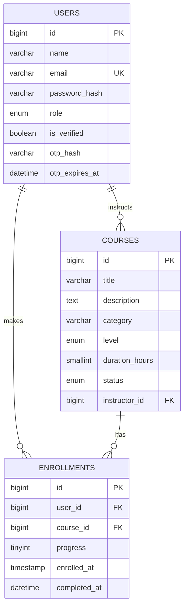

# LearnSpace ER diagram

`users` stores student/admin accounts and hashed verification codes. `courses` stores the learning catalogue. `enrollments` is the many-to-many bridge between students and courses and stores progress.
